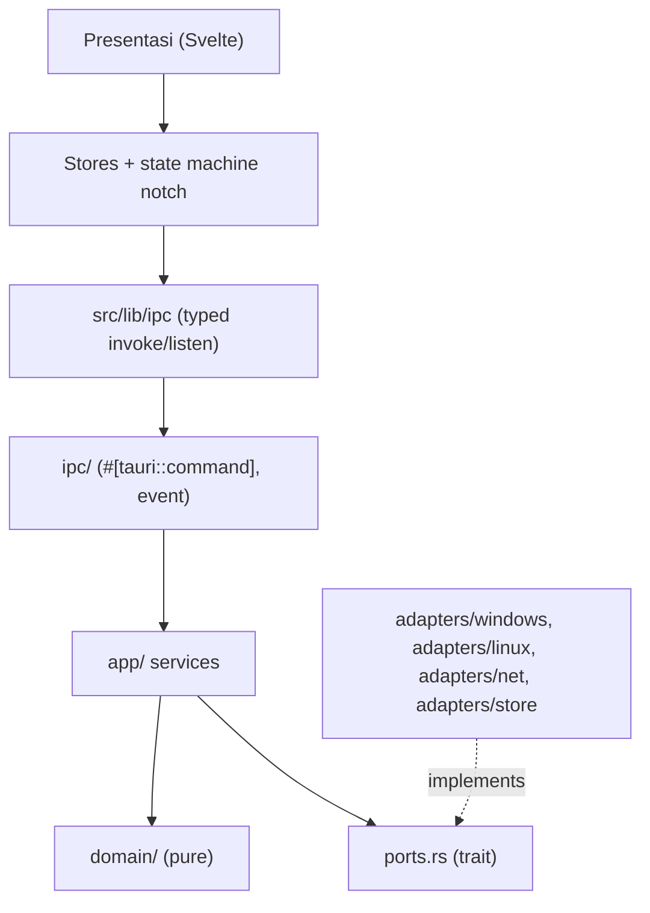

# Arsitektur — Living Notch

Status: target. Kode baseline belum mengikuti struktur ini. Migrasi dilakukan per fitur (lihat CLAUDE.md §5).

## 1. Pandangan 4+1 (ringkas)

| Pandangan | Isi |
|---|---|
| Logis | Lapisan: Presentasi → State frontend → IPC → Application → Domain / Ports ← Adapters |
| Proses | Satu proses Tauri (Rust) + proses WebView2. Listener OS berjalan di task tokio dan mengirim event Tauri. Tidak ada polling dari frontend |
| Pengembangan | `src-tauri/src/{ipc,app,domain,adapters}`, `ports.rs`; `src/lib/{ipc,stores,components}` |
| Fisik | Satu binary + installer NSIS/MSI. Data di `app_data_dir()`. Token di Windows Credential Manager |
| Skenario | UC-01..15 di `use-cases.md` |

## 2. Diagram lapisan

Port yang direncanakan:

| Port | Adapter Windows | Fitur |
|---|---|---|
| `MediaSource` | SMTC | KF-010..014 |
| `PowerSource` | WinRT power/battery | KF-030..034 |
| `DisplaySource` | Enumerasi monitor + event perubahan tampilan | KF-090..093 |
| `LyricsProvider` | LRCLIB HTTP | KF-020..023 |
| `CalendarSource` | Parser iCalendar + HTTP/file | KF-100..104 |
| `NotificationSource` | UserNotificationListener (spike S-1) | KF-110..112 |
| `GitHubSource` | REST API | KF-120..122 |
| `BluetoothSource` | WinRT Bluetooth | KF-080..081 |
| `PrivacySource` | (spike S-3) | KF-140 |
| `Store` | File JSON atomik | to-do, water, fokus, cache |
| `SecretStore` | Credential Manager | KNF-011 |

## 3. State machine notch (frontend)

State: `Resting`, `Closed`, `Expanded(fitur)`, `Wide(lirik)`, `Alert(jenis)`.
Prioritas alert (tinggi → rendah): `charging` > `calendar` > `deadline` > `focus` > `notification` > `github` > `reminder(water)` > `summary`.

| Dari | Event [guard] / action | Ke |
|---|---|---|
| Resting | `media.playing` / — | Closed |
| Closed | `media.stopped` / — | Resting |
| Resting, Closed | `hover.enter` / simpan base | Expanded(fitur aktif) |
| Expanded | `hover.leave` / — | base |
| Expanded(music) | `lyrics.open` [lirik tersedia] / — | Wide(lirik) |
| Wide | `lyrics.close` atau `hover.leave` / — | base |
| * | `alert(a)` [tidak ada alert aktif ∧ (jeda ≥ 10 dtk sejak alert terakhir ∨ a = charging)] / mulai timer durasi | Alert(a) |
| * | `alert(a)` [selain itu] / antrekan a (urut prioritas) | (tetap) |
| Alert(b) | `alert(a)` [a = charging ∧ b ≠ charging] / antrekan b | Alert(a) |
| Alert | `alert.timeout` [antrean kosong] / — | dasar/overlay |
| Alert | `alert.timeout` [kepala antrean siap: jeda ≥ 10 dtk ∨ charging] / ambil kepala | Alert(next) |
| (tanpa alert) | `tick` [kepala antrean siap] / ambil kepala | Alert(next) |
| * | `alert(a)` [focus aktif ∧ prio(a) < focus] / tahan (KF-043) | (tetap) |
| * | `focus.ended` / pindahkan alert tertahan ke antrean | (sesuai antrean) |

Catatan implementasi: alert tampil di atas overlay hover. Setelah alert selesai, notch kembali ke Expanded/Wide bila kursor masih di atasnya. Hanya `charging` yang boleh menyela alert lain dan mengabaikan jeda minimum (KNF-010). Implementasi: `src/lib/notch/machine.ts` (murni) + `store.svelte.ts` (timer, resize window).

## 4. Kontrak IPC (rencana, akan diperbarui per inkremen)

Event (Rust → frontend). Payload `snake_case`, dengan tipe yang cocok di `src/lib/ipc/types.ts`:

| Event | Payload |
|---|---|
| `media://changed` | `{ title, artist, album, artwork_b64?, duration_ms, position_ms, timestamp_ms, playing }` atau `null` |
| `power://changed` | `{ percent, charging, has_battery }` |
| `display://changed` | `{ x, y, width, scale }` |
| `lyrics://loaded` | `{ track_key, lines: [{ time_ms, text }] }` atau `null` |
| `calendar://next` | `{ title, location?, start_ms, meeting_url? }` atau `null` |
| `alert://raised` | `{ kind, priority, duration_ms, payload }` |
| `notification://received` | `{ app, sender, received_ms }` |
| `github://changed` | `{ failed_runs, review_requests }` |

Command yang sudah ada:

| Command | Argumen | Hasil |
|---|---|---|
| `window_set_bounds` | `{ width, height }` (piksel logis, 16..=2000) | `Result<(), AppError>`. Window diubah ukurannya lalu diletakkan di tengah atas monitornya |

`AppError` diserialisasi sebagai `{ kind: "invalid_argument" \| "window", message }` (`src-tauri/src/error.rs` ↔ `src/lib/ipc/types.ts`).

Command rencana: `media_command(action)`, `focus_start/pause/cancel`, `todo_*`, `water_log`, `calendar_set_sources`, `github_set_token`, `settings_get/set`. Semua mengembalikan `Result<T, AppError>`.

## 5. Keputusan arsitektur

| ADR | Judul |
|---|---|
| [0001](adr/0001-push-bukan-poll.md) | Push event OS, bukan polling frontend |
| [0002](adr/0002-state-machine-notch.md) | Satu state machine notch di frontend |
| [0003](adr/0003-persistensi-json.md) | Persistensi JSON atomik |
| [0004](adr/0004-error-policy.md) | Error policy `Result<T, AppError>` |
