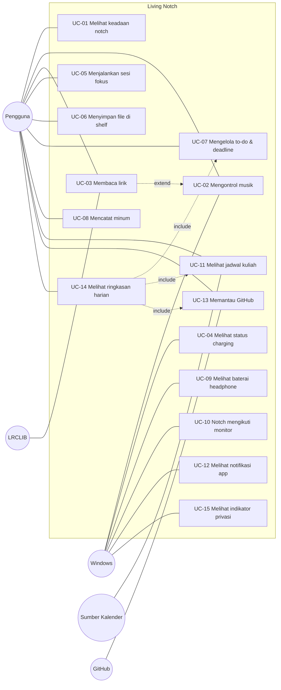

# Use Case — Living Notch

Aktor: **Pengguna** (manusia). Aktor sekunder: **Windows** (media, power, display, notifikasi), **LRCLIB**, **Sumber Kalender**, **GitHub**, **Player Musik**.

Setiap skenario terdiri dari **N** (normal), **A** (alternatif), dan **E** (eksepsi).

---

### UC-01 Melihat keadaan notch — KF-001..007
- **N:** 1) App berjalan dalam keadaan Resting. 2) Pengguna mengarahkan kursor ke notch. 3) Notch melebar ke Expanded. 4) Kursor pergi, notch kembali ke keadaan semula.
- **A1:** Musik sedang diputar, jadi keadaan dasarnya Closed, bukan Resting.
- **A2:** Alert masuk saat Expanded. Alert tampil, lalu notch kembali ke Expanded/keadaan sebelumnya.
- **E1:** Dua alert datang bersamaan. Alert berprioritas tertinggi tampil lebih dulu dan sisanya diantrekan (KF-006).
- **E2:** Klik di luar pil diteruskan ke aplikasi di bawah (KF-007).

### UC-02 Mengontrol musik — KF-010..014
- **N:** 1) Player mulai memutar lagu. 2) Windows melaporkan sesi media. 3) Notch menampilkan judul, artis, sampul, dan progres. 4) Pengguna menekan next. 5) Player pindah lagu dan notch diperbarui.
- **A1:** Ada beberapa player aktif. Sistem mengikuti sesi yang dipilih Windows sebagai sesi saat ini.
- **E1:** Player ditutup. Tidak ada sesi, sehingga kontrol disembunyikan dan notch kembali ke Resting (KF-013).
- **E2:** Player menolak perintah. Status terakhir tetap tampil (KF-014).
- **E3:** Sumber media sistem error. Widget kosong dan app tetap jalan (KNF-006).

### UC-03 Membaca lirik — KF-020..023
- **N:** 1) Lagu berganti. 2) Sistem meminta lirik ke LRCLIB. 3) Pengguna membuka mode lirik dan notch masuk Wide. 4) Baris yang sesuai disorot.
- **A1:** Lirik sudah ada di cache, jadi tidak ada request jaringan.
- **E1:** Lirik tidak ditemukan. Mode musik biasa tanpa pesan error (KF-021).
- **E2:** Tidak ada internet. Sistem memakai cache bila ada, dan jika tidak ada sama dengan E1 (KF-023).
- **E3:** Format lirik rusak. Baris yang rusak dilewati.

### UC-04 Melihat status charging — KF-030..034
- **N:** 1) Pengguna mencolokkan charger. 2) Windows melaporkan perubahan power. 3) Alert charging tampil dengan persentase, lalu notch kembali.
- **A1:** Charger dicabut. Alert singkat tampil (KF-031).
- **A2:** Baterai < 15%. Alert baterai rendah tampil satu kali (KF-034).
- **E1:** Perangkat desktop tanpa baterai. Indikator disembunyikan (KF-033).

### UC-05 Menjalankan sesi fokus — KF-040..045
- **N:** 1) Pengguna memulai fokus. 2) Hitung mundur 25 menit. 3) Alert "istirahat" tampil. 4) Istirahat 5 menit. 5) Alert "fokus lagi" tampil.
- **A1:** Pengguna menjeda lalu melanjutkan.
- **A2:** Alert lain masuk saat fokus. Alert berprioritas rendah ditahan (KF-043).
- **E1:** App ditutup di tengah sesi. Sisa waktu dipulihkan saat app dibuka kembali (KF-045).
- **E2:** Laptop sleep. Waktu dihitung dari jam dinding, sehingga fase bisa sudah berakhir saat bangun.

### UC-06 Menyimpan file di shelf — KF-050..052
- **N:** 1) Pengguna menyeret file ke notch. 2) Item muncul di shelf. 3) Pengguna menyeret item ke aplikasi lain.
- **E1:** File asli dipindah atau dihapus. Item ditandai tidak tersedia (KF-052).
- **E2:** Yang dijatuhkan bukan file (misalnya teks). Ditolak tanpa efek.

### UC-07 Mengelola to-do & deadline — KF-060..063
- **N:** 1) Pengguna menambah tugas dengan jatuh tempo. 2) Satu jam sebelum jatuh tempo, alert tampil. 3) Pengguna menandai tugas selesai.
- **A1:** Tugas tanpa jatuh tempo. Tidak ada alert.
- **E1:** File data rusak. File di-backup lalu mulai dengan daftar kosong (KF-063).
- **E2:** Jatuh tempo sudah lewat saat app dibuka. Alert "terlewat" tampil satu kali.

### UC-08 Mencatat minum — KF-070..073
- **N:** 1) Pengingat tampil sesuai interval. 2) Pengguna mencatat minum. 3) Progres dan chart diperbarui.
- **A1:** Di luar jam aktif. Tidak ada pengingat.
- **E1:** Pengingat diabaikan. Tidak ada pengingat tambahan sebelum interval berikutnya (KF-072).
- **E2:** Lewat tengah malam. Progres diatur ulang (KF-073).

### UC-09 Melihat baterai headphone — KF-080..081
- **N:** 1) Earbuds terhubung. 2) Persentase baterai tampil.
- **E1:** Perangkat tidak melaporkan baterai. Tampil "tidak tersedia" (KF-081).

### UC-10 Notch mengikuti monitor — KF-090..093
- **N:** 1) Pengguna mencolokkan monitor eksternal. 2) Windows melaporkan perubahan tampilan. 3) Notch pindah ke tengah atas monitor eksternal.
- **A1:** Monitor dicabut. Notch pindah ke layar laptop (KF-092).
- **A2:** Skala/resolusi berubah. Notch diposisikan ulang (KF-093).
- **E1:** Ada lebih dari satu monitor eksternal. Notch dipasang di monitor eksternal yang menjadi primary display Windows, atau jika tidak ada, di monitor eksternal pertama (asumsi A-6).
- **E2:** Laptop dalam mode clamshell (layar internal mati). Notch berada di monitor eksternal.

### UC-11 Melihat jadwal kuliah — KF-100..104
- **N:** 1) Pengguna mendaftarkan URL .ics. 2) Sistem menyinkronkan kalender. 3) Event berikutnya tampil di Expanded. 4) 10 menit sebelum kelas, alert tampil. 5) Pengguna menekan "buka link" rapat.
- **A1:** Sumber berupa file lokal.
- **E1:** URL tidak dapat diakses atau tidak ada internet. Data terakhir tampil dengan waktu sinkron (KF-104).
- **E2:** File .ics tidak valid. Sumber ditandai error di pengaturan dan sumber lain tetap jalan.

### UC-12 Melihat notifikasi app — KF-110..112 (bergantung spike S-1)
- **N:** 1) Pesan WhatsApp masuk. 2) Windows menampilkan toast. 3) Notch menampilkan nama app dan pengirim selama ≤ 5 detik.
- **A1:** App tidak ada di daftar izin. Diabaikan.
- **A2:** Sesi fokus berjalan. Notifikasi ditahan (KF-043).
- **E1:** Izin ditolak atau API tidak didukung. Fitur disembunyikan (KF-112).

### UC-13 Memantau GitHub — KF-120..122
- **N:** 1) Pengguna memasukkan token dan memilih repositori. 2) CI gagal. 3) Alert tampil.
- **A1:** Ada PR yang meminta review. Jumlahnya tampil di Expanded.
- **E1:** Token kedaluwarsa atau batas API tercapai. Fitur dinonaktifkan sementara (KF-122).
- **E2:** Tidak ada internet. Data terakhir tetap tampil.

### UC-14 Melihat ringkasan harian — KF-130..131
- **N:** 1) Pengguna login pertama kali hari itu. 2) Ringkasan kelas, deadline, dan PR tampil.
- **E1:** Ada sumber data yang tidak tersedia. Bagian itu dilewati (KF-131).
- **E2:** Semua sumber kosong. Ringkasan tidak ditampilkan.

### UC-15 Melihat indikator privasi — KF-140 (bergantung spike S-3)
- **N:** 1) Aplikasi meeting menyalakan mikrofon. 2) Indikator tampil di notch. 3) Mikrofon mati, indikator hilang.
- **E1:** Status tidak bisa dibaca. Indikator tidak ditampilkan dan tidak ada error.
